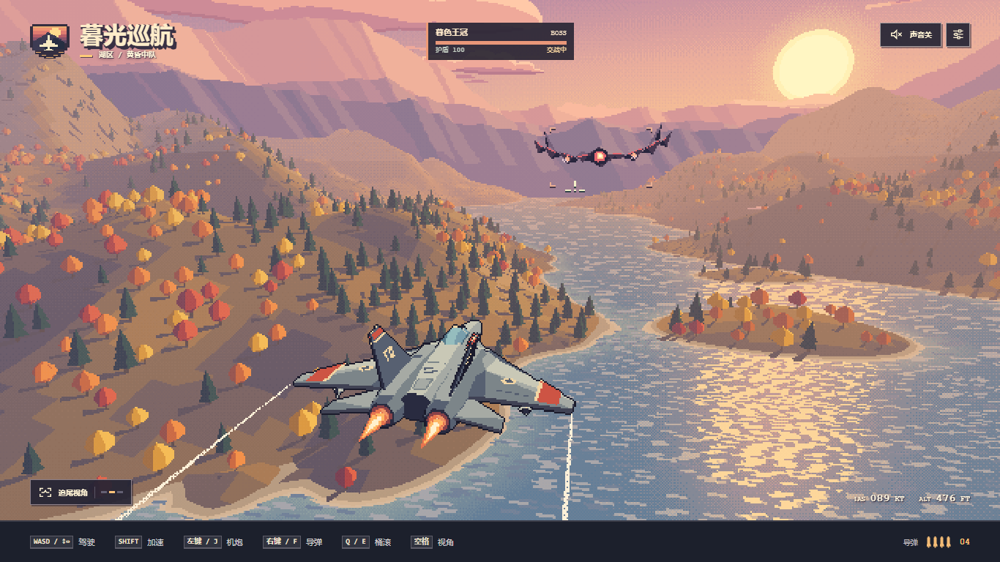

# Dusk Patrol · 暮光巡航

Fly a twin-engine jet over autumn lakes at sunset and take on the Vesper Crown. Follow the target brackets, line up the nose and hold the cannon trigger. When the Crown's core brightens, turn out of its path. At half health it begins firing volleys. Defeating the Crown gives you eight seconds to regroup before the next encounter.

[Play in your browser](https://fighter-pixel-game.vercel.app) or download the single-file HTML from the [latest release](https://github.com/chnoorlee/Fighter-Pixel-Game/releases/latest). The game uses raw WebGL 2 for the world, Canvas 2D for the cockpit and Web Audio for sound. Sound starts muted. Settings lets you choose English or 简体中文.

| Action | Desktop | Phone |
| --- | --- | --- |
| Turn left / right | A / D or left / right arrow | Tilt left / right |
| Climb / dive | W / S or up / down arrow | Raise / lower the top edge from your calibrated grip |
| Afterburner | Hold Shift | Hold Boost on the right |
| Cannon | Hold the left mouse button or J | Hold Cannon on the right |
| Missile | Right-click or press F | Tap Missile on the right |
| Barrel roll | Q for left, E for right | Steer around the pulse with tilt |
| Change view | Space | Tap the camera button |

On a phone, open the HTTPS game link and hold your device in a comfortable flying position. Tap **Enable motion** if prompted. Tilt sets your course in portrait and landscape. Open Settings and choose **Recenter tilt** to change your neutral grip. Boost and Cannon can be held together while a third finger taps Missile.

**中文版**　用机炮或导弹击破「暮色王冠」。它的核心发亮时准备转向躲避；半血后会发射三路脉冲。电脑用 WASD 或方向键驾驶，Shift 加速，按住左键或 J 开机炮，右键或 F 发导弹，Q / E 向左或向右桶滚，空格切换视角。

手机通过倾斜操纵。首次打开时自然握住手机，出现权限提示时点「启用体感」。向左右倾斜转弯，抬高手机上沿爬升，压低上沿俯冲。右侧可以同时按住加力、机炮，再点按导弹。点设置可以重新校准握姿，也可以切换中英文。
